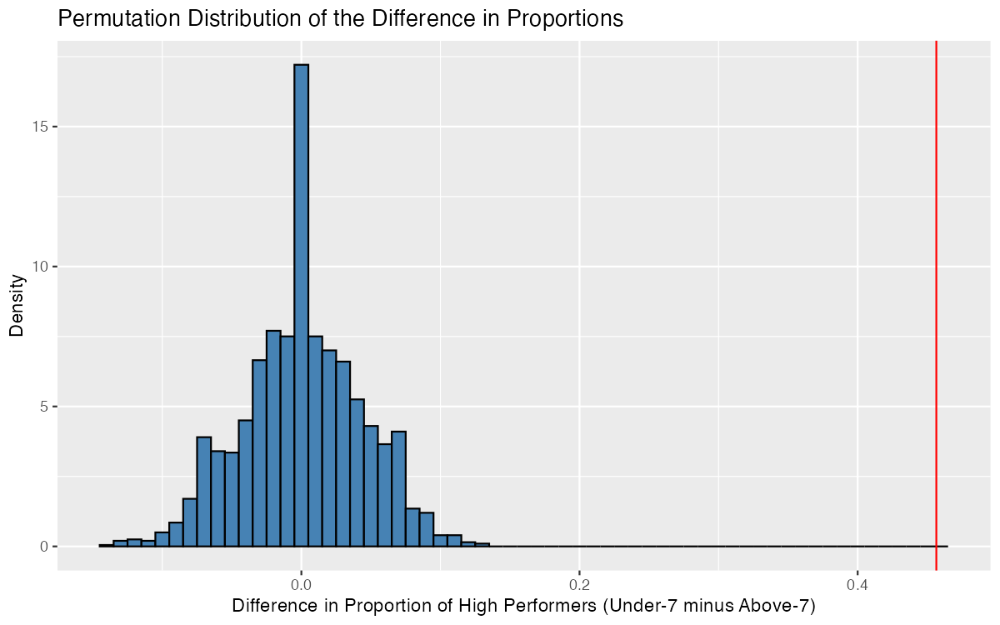
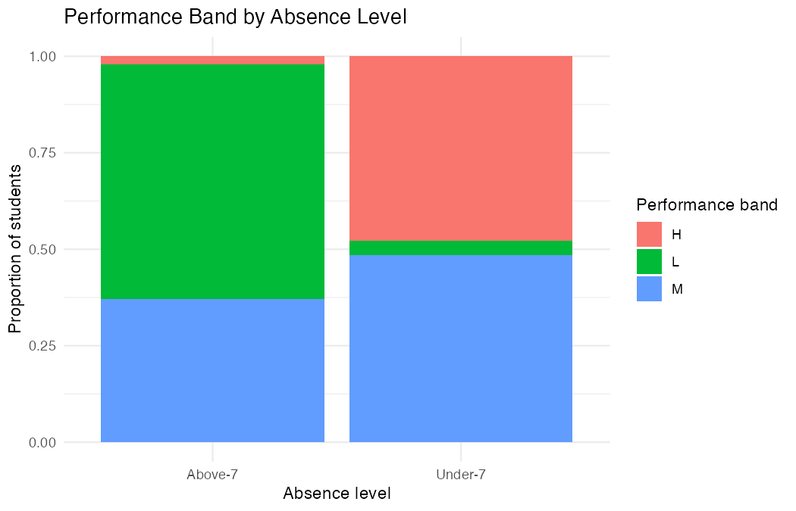

# Student Absenteeism and Academic Performance

*September – October 2026 · R, ggplot2, mosaic*

Does absenteeism relate to academic performance and classroom engagement?
A statistical analysis of 480 student records.



The red line marks the observed difference of 0.4566 — far outside anything
1,999 random permutations of the absence labels produced (−0.14 to +0.14).

## Question

Students were grouped by absence level (under 7 days vs over 7 days), and four
questions were investigated:

1. Do low-absence students reach the high-performance band more often?
2. Do they access course content more?
3. Do they visit discussion posts more?
4. Does the *variability* of participation differ between the groups?

## Results

**Performance.** 47.8% of low-absence students reached the high-performance
band (138 of 289) versus 2.1% of high-absence students (4 of 191) — a
difference of 45.7 percentage points. Permutation P = 0.0005;
95% CI [0.3901, 0.5134].



**Resource use.** Low-absence students visited course content 33.7 more times
on average (68.2 vs 34.5); Welch t(380.5) = 12.36, P < 2.2e-16.

**Discussion.** 12.3 more visits on average (48.2 vs 35.9);
Welch t(410.3) = 4.91, P = 6.46e-07; bootstrap 95% CI [7.39, 17.25].

**Variability.** No statistically significant difference in the spread of
raised-hand participation (SD 28.2 vs 25.9); Levene's F(1, 478) = 2.81,
P = 0.094.

## Methods

| Question | Method | Why |
|---|---|---|
| Performance band | Permutation test on two proportions, 1,999 permutations | Condition-free; assumes nothing about the population distribution |
| Resource visits | Welch two-sample t-test | Unequal variances between groups |
| Discussion visits | Welch t-test + bootstrap CI | Skewed data; bootstrap for the interval |
| Variability | Levene's test | Compares spread rather than centre |

## Interpretation

Lower absenteeism was associated with higher *levels* of performance and
engagement, but not with reduced *variability* in participation.

## Limitations

The data are observational, so these are associations rather than causal
effects — absenteeism and engagement are plausibly both driven by factors not
measured here. The engagement variables (resource visits, discussion visits,
hands raised) are platform-logged counts and may not reflect learning quality.
The data come from a single learning-management system, so the findings may
not generalise.

## Data

[Students' Academic Performance Dataset (xAPI-Edu-Data)](https://www.kaggle.com/datasets/aljarah/xAPI-Edu-Data)
by Ibrahim Aljarah, licensed under
[CC BY-SA 4.0](https://creativecommons.org/licenses/by-sa/4.0/).
480 students, 17 variables covering demographics, engagement behaviours, and a
three-level performance band (Low / Middle / High). Included unmodified in
`dataset/`.

## Repository

```
gq1-performance-analysis.Rmd    my analysis (Question 1)
gq1-performance-analysis.pdf    knitted output
full-report.pdf                 the group's combined report, all four questions
figures/                        plots generated by the analysis
dataset/                        xAPI-Edu-Data.csv
group-analyses/                 my teammates' analyses (Questions 2–4)
```

## Reproducing

```r
install.packages(c("ggplot2", "mosaic", "dplyr"))
```

Knit `gq1-performance-analysis.Rmd`, or run it top to bottom. `set.seed(2026)`
is set, so the permutation results reproduce exactly.

## Contributions

Completed as a four-person group project for a graduate statistics course.

**My work:** Question 1 — permutation test on the difference in two
proportions, with a plus-one/plus-two confidence interval — and the full
conclusions section of the report: results summary, comparison table across all
four questions, and the synthesis of findings. Code in
`gq1-performance-analysis.Rmd`; Section 5 of `full-report.pdf`.

**Other contributors:** Jose Garcia (Question 2), Patrick Amoni (Question 3),
Eric Jiang (Question 4). Their analyses are in `group-analyses/`, included with
their agreement.

---

[LinkedIn](https://www.linkedin.com/in/bhavya-dadhich/) · bhavya.dadhich22@gmail.com
